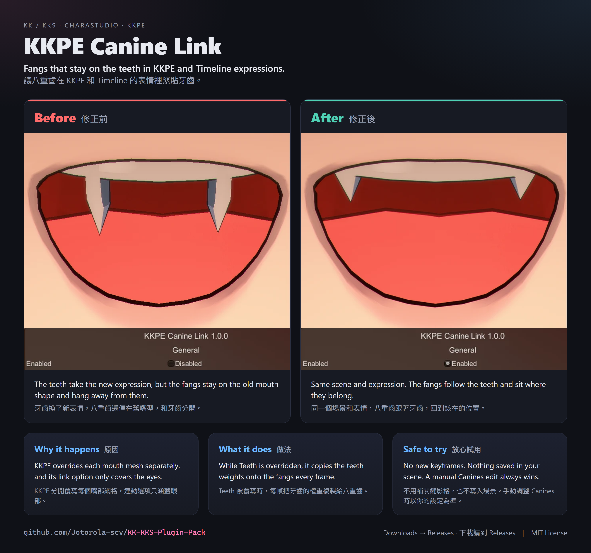

# KKPE Canine Link

Part of the [KK/KKS Plugin Pack](../README.md). **Optional:** only needed if you animate or edit the mouth with KKPE blendshapes on characters with fangs.

A small BepInEx fix for **CharaStudio** in **Koikatsu (KK)** and **Koikatsu Sunshine (KKS)**.

## The problem

Mouth expressions drive the face, teeth and fangs together, so they normally match. KKPE overrides each mesh on its own. Its *Link eyes components* option covers the eyes, not the teeth and fangs. If you override **Teeth** in KKPE or keyframe it in Timeline but leave **Canines** alone, the fangs stay on the game's mouth pattern while the teeth take the new one. The fangs then sit somewhere else than the teeth.

## The fix

While Teeth is overridden in KKPE and Canines is not, the plugin copies the teeth blendshape weights onto the canines every frame, so the fangs follow manual edits and Timeline playback.

- Nothing is saved in the scene or card. Scenes look the same as before if you remove the plugin.
- A manual Canines override always wins: the plugin leaves that character alone.
- Existing scenes work without new keyframes.
- *Plugin settings > KKPE Canine Link > Enabled* turns it off, which is how the image above was made.

## Installation

Download `KK_CanineLink.rar` (Koikatsu / Koikatsu Party) or `KKS_CanineLink.rar` (Koikatsu Sunshine) from [Releases](https://github.com/Jotorola-scv/KK-KKS-Plugin-Pack/releases/tag/KKPECanineLink-v1.0.1) and extract it into `BepInEx/plugins`. The archive also contains [EditFangs Head Fix](../EditFangsHeadFix/README.md). Requires BepInEx 5 and KKPE (tested with 2.21.5). Without KKPE this dll does not load and BepInEx notes that in its log. Delete `KK_KKPECanineLink.dll` or `KKS_KKPECanineLink.dll` to uninstall.

## Limitations

- The fangs follow **Teeth**. If you only override *Eyes / Mouth*, teeth and fangs both stay on the game's pattern, as they do without the plugin.
- If fangs look stretched or twisted on a modded head in Studio, that is a different problem: see [EditFangs Head Fix](../EditFangsHeadFix/README.md).

## Tested in game

Both games, CharaStudio, with a Timeline-animated scene.

## Credits

- **Code:** written by **Claude**, Anthropic's AI assistant. **Problem report, direction and in-game testing:** [Jotorola-scv](https://github.com/Jotorola-scv).
- Works with KKPE by Joan6694. It is not affiliated with that project.
- License: MIT

---

## 中文說明

**選用**：只有用 KKPE 的 blendshape 編輯嘴型或做動畫、而且角色開了八重齒時才需要。適用於 KK 和 KKS 的 CharaStudio。

**問題：** 遊戲的嘴型表情會同時驅動臉、牙齒和八重齒，所以平常三者一致。KKPE 則是分開覆寫每個網格，它的 *Link eyes components* 只連動眼部，不包含牙齒和八重齒。如果在 KKPE 或 Timeline 改了 **Teeth**、沒有動 **Canines**，牙齒會換成新嘴型，八重齒卻還停在遊戲原本的嘴型，兩者就對不上了。

**修正：** 當 Teeth 被 KKPE 覆寫、Canines 沒有時，插件每幀把牙齒的 blendshape 權重複製給八重齒，手動調整和 Timeline 播放都會跟著動。

- 不會寫入場景或角色卡。移除插件後，場景和原本一樣。
- 手動覆寫 Canines 時一律以你的設定為準，插件不會介入該角色。
- 舊場景不用補關鍵影格。
- 可以在插件設定的 *KKPE Canine Link > Enabled* 關閉，上面的對比圖就是這樣拍的。

**安裝：** 從 [Releases](https://github.com/Jotorola-scv/KK-KKS-Plugin-Pack/releases/tag/KKPECanineLink-v1.0.1) 下載 `KK_CanineLink.rar`（戀活）或 `KKS_CanineLink.rar`（戀活 Sunshine），解壓縮到 `BepInEx/plugins`。壓縮檔裡也包含 [EditFangs Head Fix](../EditFangsHeadFix/README.md#中文說明)。需要 BepInEx 5 和 KKPE（測試版本 2.21.5）；沒有 KKPE 時這個 dll 不會載入，BepInEx 會在 log 裡註明。刪除 `KK_KKPECanineLink.dll` 或 `KKS_KKPECanineLink.dll` 即可解除安裝。

**限制：** 八重齒跟隨的是 **Teeth**。如果只覆寫 *Eyes / Mouth*，牙齒和八重齒都會維持遊戲原本的嘴型，和沒裝插件時一樣。如果移植頭模的八重齒在 Studio 裡被拉長或扭曲，那是另一個問題，請看 [EditFangs Head Fix](../EditFangsHeadFix/README.md#中文說明)。

**遊戲內測試：** KK 和 KKS 的 CharaStudio，使用有 Timeline 動畫的場景。

---

## 日本語の概要

**任意**：八重歯のあるキャラの口を KKPE のブレンドシェイプで編集・アニメーションする場合だけ必要です（KK / KKS の CharaStudio）。KKPE はメッシュごとに上書きするため、**Teeth** だけを変更すると八重歯がゲーム本来の口の形に残り、歯からずれます。このプラグインは、Teeth が上書きされていて Canines が上書きされていない間、歯のウェイトを八重歯にコピーします。シーンやカードには何も保存せず、Canines を手動で上書きした場合はそちらを優先します。[Releases](https://github.com/Jotorola-scv/KK-KKS-Plugin-Pack/releases/tag/KKPECanineLink-v1.0.1) から `KK_CanineLink.rar` または `KKS_CanineLink.rar` をダウンロードし、`BepInEx/plugins` に展開してください（EditFangs Head Fix も同梱）。
